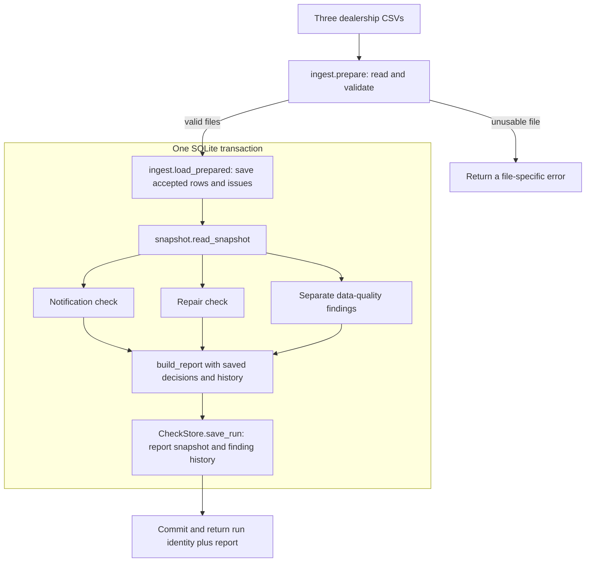

# Architecture overview

The Recall Campaign Tracker checks synthetic records from one dealership.
It identifies affected vehicle/campaign pairs with no notice on file or a
repair outside the chosen day limit, while keeping bad-data evidence
separate. A recall coordinator reviews the results and records a decision.

The current implementation is a Python backend with a CLI, a local JSON
API and a SQLite database, plus a plain HTML/CSS/JavaScript coordinator UI
in [ui/](../../ui/) that the same server serves. The API and report
contract are the integration points for the UI. PDF export uses the
browser's print-to-PDF; there is no PDF endpoint.

## Components and responsibilities

- [generate.py](../../recall_tracker/generate.py),
  [plant.py](../../recall_tracker/plant.py) and
  [vin.py](../../recall_tracker/vin.py) create deterministic synthetic
  CSVs, deliberate business/data-quality cases, a planted-issue log and a
  manifest containing file hashes and row counts.
- [ingest.py](../../recall_tracker/ingest.py) reads and validates all three
  CSVs, records row issues, handles duplicates and writes accepted rows.
  [normalize.py](../../recall_tracker/normalize.py) owns safe formatting
  fixes and value validation.
- [snapshot.py](../../recall_tracker/snapshot.py) reads one complete ingest
  into immutable contract records. It constructs the shared
  [AffectedList](../../recall_tracker/affected.py) once, preserving pair
  identity and source order. There is no second CSV parser in this layer.
- [checks.py](../../recall_tracker/checks.py) contains the notification and
  repair checks. They consume the same affected list and accepted facts;
  date selection and inclusive counting live in
  [contract/days.py](../../recall_tracker/contract/days.py).
- [contract/](../../recall_tracker/contract/) defines validated records for
  facts, findings, decisions, history and vehicle views.
  [report.py](../../recall_tracker/contract/report.py) assembles and
  validates the report; [serialize.py](../../recall_tracker/contract/serialize.py)
  converts it to JSON-ready values with ISO dates.
- [storage.py](../../recall_tracker/storage.py) saves original reports,
  finding history, decisions and the selected day limit. Its `CheckStore`
  uses a caller-owned connection and leaves commit/rollback to the caller.
- [pipeline.py](../../recall_tracker/pipeline.py) coordinates ingest,
  snapshots, checks, reporting and persistence, including the transaction
  boundary and recalculation of loaded data.
- [__main__.py](../../recall_tracker/__main__.py) exposes the CLI.
  [api.py](../../recall_tracker/api.py) maps JSON requests to the same
  pipeline functions and provides the local HTTP server, which also serves
  the UI files.
- [ui/](../../ui/) is the coordinator UI: `index.html`, `style.css` and
  `app.js`, with no build step and no dependencies. It reads the API and
  renders the report payload; see "Coordinator UI" below.

## Inputs and identity

The three input files are:

- `affected_vehicles.csv`: `vin`, `campaign_id`.
- `notices_sent.csv`: `vin`, `campaign_id`, `notice_date`.
- `repairs_done.csv`: `vin`, `campaign_id`, `repair_date`, optional `tech_note`.

The case key is **VIN plus campaign ID**. One VIN in two campaigns is two
cases. Affected membership comes entirely from accepted rows of the
affected file. Manufacturer data, build-date calculations, ownership,
returns, resales and central-body data are outside the current checks.

The generator also emits `planted_issues.csv` and `manifest.json`. These
support reproducibility and tests; the business checks do not use the
planted answers to decide which vehicles to flag.

## What happens during a new check



`pipeline.run_check()` performs the following work:

1. Validate the requested check date and optional day limit. A new check
   defaults to today's date; CLI `--as-of` or API `check_date` overrides it.
2. Call `ingest.prepare()` before opening the database. It reads all files,
   applies safe fixes, validates rows and checks row balance in memory.
3. Open SQLite with foreign-key enforcement and begin an immediate write
   transaction. `ingest.load_prepared()` writes a new ingest and verifies
   its persisted row counts.
4. Read that exact ingest into an `IngestSnapshot`: its ID, as-of date,
   affected list, accepted facts and all row issues. Historical reads are
   also constrained to one ingest ID, so uploads cannot be mixed.
5. Load the saved repair-day limit, defaulting to 60, or save an explicitly
   supplied positive integer limit within the same transaction.
6. Run both business checks against the same affected list. Accepted
   notice/repair pairs outside that list remain available for quality
   reporting but never generate business findings.
7. Assemble the report with current decisions and earlier finding history,
   then append the run and its new history rows.
8. Commit before returning the saved run. Any failure inside the transaction
   rolls back the ingest, setting change and check results together.

The standalone `python -m recall_tracker.ingest` command stops after saving
an ingest. The `check` command includes ingest, so it does not require a
separate ingest command first. `recheck` can evaluate a database created by
the standalone ingest command.

## Validation and bad-data handling

Ingest reads cells as text and maps supported header variants to canonical
columns. Safe fixes include VIN case/spacing, readable campaign-ID variants
and supported date formats. Accepted dates are stored as `YYYY-MM-DD`.
Dates after the ingest's as-of date are quarantined.

Row issues have one of three actions:

- **Quarantined:** `MISSING_VALUE`, `BAD_VIN`, `BAD_CAMPAIGN`, `BAD_DATE` and
  `FUTURE_DATE`. The whole original row is retained; it is excluded from
  the accepted source table.
- **Dropped duplicate:** `DUPLICATE_ROW`. The first accepted pair/date stays.
  Repair-note text is not part of the duplicate key.
- **Kept:** `DATE_CONFLICT`, `REPAIR_BEFORE_NOTICE` and `NOT_IN_AFFECTED`.
  Accepted facts remain available, with a separate reason describing the
  problem. The pipeline creates data-quality findings for kept issues
  whose pair has accepted facts, deduplicating identical pair/reason flags.

All issue actions remain visible in the report's `data_issues`, including
rows without a usable VIN or campaign. Quarantined and duplicate rows do
not become business findings merely because they have an issue.

For every source file, ingest checks:

```text
raw data rows = accepted rows + quarantined rows + dropped duplicates
```

Row numbers count the header as row 1. Completely blank rows are skipped.
A header-only file with all required columns is a valid empty input.

A missing, unreadable, malformed or empty file, or one lacking a required
column, stops the entire operation before database writes. This is
different from an invalid row inside an otherwise usable file. A failed
file load never becomes evidence that every vehicle is unnotified or
unrepaired.

## Business checks

### Notification

An affected pair takes a notification finding when it has no accepted
notice and no matching quarantined notice with readable VIN/campaign
identifiers. A notice with a bad date still proves presence in the notices
file; it remains a data issue, without starting a usable repair clock.
There is no notification-deadline or NHTSA clock in this rule.

### Repair

The earliest accepted notice starts the clock. The earliest accepted
repair on or after that notice closes it. The calculation includes both
calendar dates:

```text
inclusive_days = (end_date - notice_date).days + 1
```

With the default limit of 60, a January 1, 2026 notice followed by a March 1
repair is on time at day 60; a March 2 repair is late at day 61. Without a
usable repair, the check date is the end date, and a repair finding appears
only when the count exceeds the limit.

No accepted notice date means no repair clock. A repair before notice
does not close it. Conflicting or later rows never restart the clock;
their data-quality flags remain separate from any overdue/late finding.

Notification and repair have equal standing. The pipeline preserves
affected-file order rather than ranking cases by finding kind. Technician
notes are stored as text and are not inputs to these checks.

## SQLite storage and history

The default database is `data/recall.db`. Two groups of tables share it.

**Ingest records**, defined in `ingest.py`:

- `ingests` identifies each complete CSV load and retains its timestamps,
  as-of date, source hashes and row counts.
- `affected_vehicles`, `notices_sent` and `repairs_done` hold accepted rows
  keyed to an ingest, with source-file and source-row provenance.
- `data_issues` retains reasons and actions; `quarantine` retains original
  invalid rows. Both belong to an ingest.

The `cur_affected_vehicles`, `cur_notices_sent`, `cur_repairs_done`,
`cur_data_issues` and `cur_quarantine` views select the latest complete
ingest. Older rows are retained.

**Tool records**, defined in `storage.py`:

- `check_runs` links each evaluation to an ingest and stores its check
  date, day limit, save timestamp and original report JSON.
- `check_history` links each new finding to its run and retains the pair,
  kind, reason, check date and limit. Earlier history embedded in a report
  is not inserted again. Runs without findings still have a saved report.
- `coordinator_decisions` appends each decision with its pair, status,
  optional note, decision date and save timestamp.
- `tracker_settings` stores the selected repair-day limit.

An **ingest** is a load of source records. A **run** evaluates an ingest
using a date and limit. Several runs can reference the same ingest; a new
upload creates a new ingest. Neither operation deletes older runs or
decisions.

`CheckStore` never commits implicitly. Write transactions are controlled
by the pipeline; report/history reads use a read-only SQLite connection
and a consistent read transaction. Saved reports are deserialized through
the contract validators, and run listings read metadata without decoding
every historical report.

## Recalculation, decisions and report views

`pipeline.recheck()` reads the latest complete ingest without reopening the
CSVs. A changed limit is persisted and produces a new run. By default it
keeps the latest run's check date when that run belongs to the same ingest;
an ingest that has not been checked uses its own as-of date. An explicit
check date cannot precede the ingest's as-of date. To evaluate an earlier
date, reload the inputs for that date so future rows are validated again.

Coordinator decisions are explicit actions with status `reviewed`,
`follow up` or `no action`. A decision can reference a pair retained in
accepted source history, including a pair from an earlier upload. The
latest decision date wins; for decisions on the same date, the later
recorded one wins. Previous decisions remain in history. Saving a decision
does not rerun business checks.

There are two report views:

- **Current report:** the latest saved check results combined with current
  decisions and complete finding history. Reading it does not run checks.
  If CSVs were ingested separately afterward, it still describes the
  latest saved check; run `recheck` to evaluate the newer ingest.
- **Original saved run:** the immutable report JSON captured when that run
  was saved, including the decisions/history available at that time.
  Later decisions and uploads do not rewrite it.

The `ReportPayload` contains `check_date`, `day_limit`, `findings`,
`data_quality`, `data_issues`, `vehicles`, `decisions` and `history`.
Vehicle views expose the selected dates, inclusive count, on-time result,
current decision and underlying facts. CLI/API run responses wrap the
serialized report with `run_id` and `ingest_id`; API responses also carry
`loaded_at`, when the CSVs behind the run were read (the ingest's finish
time, in UTC), and `input_check`, whether the CSV folder still matches that
load (`ok`, `changed` or `unusable`; see `pipeline.input_check`). Saved runs
from `/api/runs/<id>` carry neither.

## Coordinator UI

`ui/app.js` fetches `GET /api/report` and renders three views from the one
payload, switching by URL hash without a page load:

- **Flags** (`#`): count cards, notification and repair findings (equal
  standing, payload order), and a separate "Missing and bad data" section for
  `data_issues` and `data_quality`. The day-limit form posts to
  `/api/day-limit`; "Run check" posts to `/api/checks`.
- **Vehicle detail** (`#/vehicle/<vin>/<campaign>`): built from the report's
  `vehicles` entry. A vehicle outside the affected list (`facts.affected`
  empty) shows no day count. The decision form posts `vin`, `campaign_id`,
  `status` and an optional `note` to `/api/decisions`, never `decided_on`
  (the server uses today's date, so the new decision is the current one), and
  reloads the report.
- **Check history** (`#/history`): saved runs from `/api/runs`, plus every
  saved check and decision from the report's `history` and `decisions`,
  filtered in the browser.

Rules the UI follows:

- Only HTTP 422 (an unusable input file) hides the findings and shows the
  error alone. A 400 on first load means no check has run yet. Other errors
  show a message and leave the screen as it is.
- Reload and day-limit changes use the already loaded data, not the CSVs, so
  after a file error they bring back the last good report. The header says
  when the data was loaded (`loaded_at`), and `input_check` drives a warning
  banner: `unusable` disables Export PDF, and `changed` adds the warning to
  the PDF cover. The print-only copy is cleared whenever the screen changes
  (a new report or an error), so Ctrl+P never prints an earlier export.
- Every value from the API, including `raw_row` and technician notes, is
  written with `textContent`, never as HTML.
- Dates are shown as `YYYY-MM-DD`. Reason text from the server uses
  `MM/DD/YYYY`, so the UI rewrites real dates when displaying them; values
  that are not real dates stay as written.
- No control contacts owners, edits a source record or decides for the
  coordinator.

**Export PDF** opens a dialog to choose the parts (findings, missing and bad
data, vehicle detail, saved runs, every saved check, decisions). `app.js`
builds a print-only copy of the loaded report, hidden on screen and shown by
the `@media print` rules in `style.css`, and calls `window.print()`; the
coordinator chooses "Save as PDF". The raw rows of data issues are left out of
the PDF. The button is disabled when no report is loaded.

## CLI and API boundaries

`python -m recall_tracker` exposes `check`, `recheck`, `report`, `runs`,
`decide` and `serve`. Generator and ingest commands remain available as
separate modules. See the [README](../../README.md) for runnable examples.

`serve` uses Python's `ThreadingHTTPServer`, listening on `127.0.0.1:8000`
by default. Each operation opens its own database connection; the API
delegates domain behavior to the pipeline. An existing Python app can
also call `Application.request()` directly. `GET /` and the `.html`, `.css`
and `.js` files under `ui/` are served as static files (GET only, nothing
outside `ui/`, `nosniff` and a `default-src 'self'` content security
policy). The UI and the API share one origin, so there are no CORS headers.

Write routes are `POST /api/checks`, `/api/recheck`, `/api/day-limit` and
`/api/decisions`. Read routes are `GET /api/report`, `/api/runs`,
`/api/runs/{run_id}`, `/api/history`, `/api/settings` and `/healthz`.

JSON POST bodies use `Content-Type: application/json`. Successful reads
return 200; successful checks/recalculations return 201 with a saved run,
and decision creation returns 201 with `decision_id`. Invalid arguments
return 400, unavailable run IDs/routes return 404, unusable CSV files
return 422, and unexpected application failures return a logged generic
500 response. The HTTP adapter also rejects unsupported content types
and oversized request bodies.

Error responses contain `error` instead of a report or empty findings
list. Expected CLI failures write the error to stderr and exit with code
2, leaving stdout free of a successful-looking report.

## Dependencies and verification

The application uses the Python standard library, including `sqlite3`,
`csv`, `json` and `http.server`. There is no ORM, web framework or external
database service. `requirements.txt` pins pytest for tests;
`requirements-dev.txt` includes the same list. CI runs pytest on Python
3.12 for pull requests and pushes to `main`.

The test layers cover generator determinism and planted cases;
normalization/ingest and database contracts; affected lists and snapshots;
business-rule boundaries; storage round trips and history; full pipeline
rollback and recalculation; API/CLI behavior; and the UI.
[test_ui.py](../../tests/test_ui.py) checks the UI source (no HTML built from
data, no inline script, every looked-up element exists) and, when Chrome is
installed, renders the page against a real server and checked data to compare
what is shown with the report payload. In particular,
[test_pipeline.py](../../tests/test_pipeline.py) exercises the rules through
the actual generator and ingest, including day 60/61, quarantined notices,
unchanged source files, persisted limits and retained decisions.

The source CSVs remain inputs throughout. The tool records its own results
and coordinator decisions; it does not contact owners, close campaigns or
edit source repair records.
